# AIForge

**Build, train and use your own AI models in the terminal, without writing any code.**

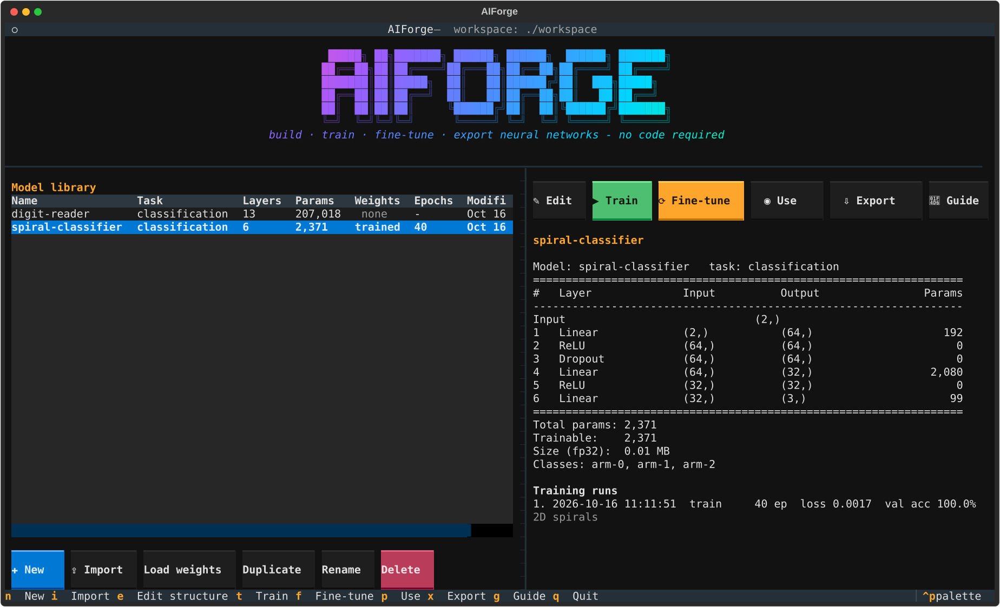

AIForge is a program that runs in your terminal. You use it with the mouse or keyboard to:

1. **Design** a neural network by choosing layers from a list
2. **Train** it on your own data: a spreadsheet (CSV), text, or a folder of images
3. **Fine-tune** a trained model so it learns a new but related task
4. **Use** the model to make predictions
5. **Export** the model so other programs (Python, ONNX Runtime, mobile apps…) can use it

You don't need to know PyTorch or Python. Some machine-learning words come up along the
way; [the glossary](#9-words-you-will-see) explains each one in plain language.

---

## Contents

1. [Before you start](#1-before-you-start)
2. [Install](#2-install)
3. [Start the app](#3-start-the-app)
4. [Tutorial: your first model in 5 minutes](#4-tutorial-your-first-model-in-5-minutes)
5. [Every screen explained](#5-every-screen-explained)
6. [Using your own data](#6-using-your-own-data)
7. [Which template should I choose?](#7-which-template-should-i-choose)
8. [How to read the training charts](#8-how-to-read-the-training-charts)
9. [Words you will see](#9-words-you-will-see)
10. [Keyboard shortcuts](#10-keyboard-shortcuts)
11. [Problems and solutions](#11-problems-and-solutions)
12. [Where are my files?](#12-where-are-my-files)
13. [For developers](#13-for-developers)

---

## 1. Before you start

You need:

| What | How to check | Notes |
|---|---|---|
| **Python 3.10 or newer** | Run `python3 --version` in a terminal | Install it from [python.org](https://www.python.org/downloads/) if it's missing |
| **A terminal** | macOS: *Terminal* or *iTerm2* · Windows: *Windows Terminal* · Linux: any | |
| **About 2 GB of free disk space** | | Mostly for PyTorch |
| **A large terminal window** | | At least **120 columns × 35 rows**. Full screen works best. |

A graphics card (GPU) is optional. AIForge automatically uses an NVIDIA GPU (CUDA) or an
Apple Silicon GPU (MPS) if it finds one. Otherwise it uses the CPU, which is fine for the
examples.

---

## 2. Install

Open a terminal and run the commands below one at a time.

**Step 1: go to the project folder**
```bash
cd path/to/AI-interact
```

**Step 2: create a private Python environment** (keeps AIForge's packages separate from the rest of your computer)
```bash
python3 -m venv .venv
```

**Step 3: install AIForge and its packages.** This downloads PyTorch, so it can take a few minutes.
```bash
# macOS / Linux
.venv/bin/pip install -e .

# Windows
.venv\Scripts\pip install -e .
```

**Step 4: check it worked**
```bash
# macOS / Linux
.venv/bin/aiforge --help

# Windows
.venv\Scripts\aiforge --help
```
You should see `usage: aiforge [-h] [-w WORKSPACE]`. If you do, the installation worked.

---

## 3. Start the app

```bash
# macOS / Linux
.venv/bin/aiforge

# Windows
.venv\Scripts\aiforge
```

> **Tip:** if you run `source .venv/bin/activate` first (Windows: `.venv\Scripts\activate`),
> you can just type `aiforge` from then on.

You will see the home screen:

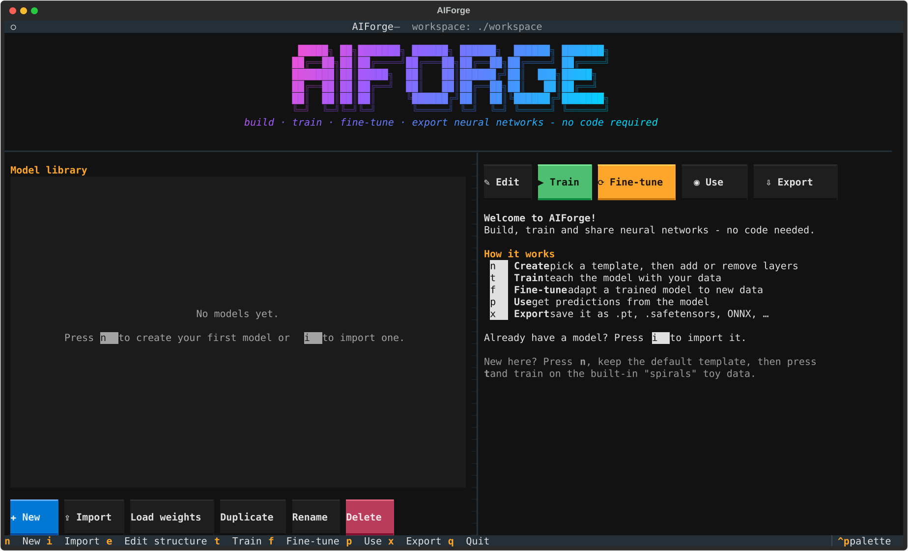

**How to move around:**
- **Click** buttons, list rows and input boxes with the mouse, *or*
- press the **keys shown in the bottom bar**, e.g. `n` = New, `t` = Train, `q` = Quit
- `Tab` moves to the next box, `Esc` goes back to the previous screen
- **Enter** confirms

To quit, press `q` on the home screen, or `Ctrl+Q` anywhere.

---

## 4. Tutorial: your first model in 5 minutes

In this tutorial you build a model that learns to tell apart three intertwined spirals of
points. The data is built into AIForge, so you don't need to download anything.

### Step 1: create the model

Press **`n`** (or click **✚ New**).

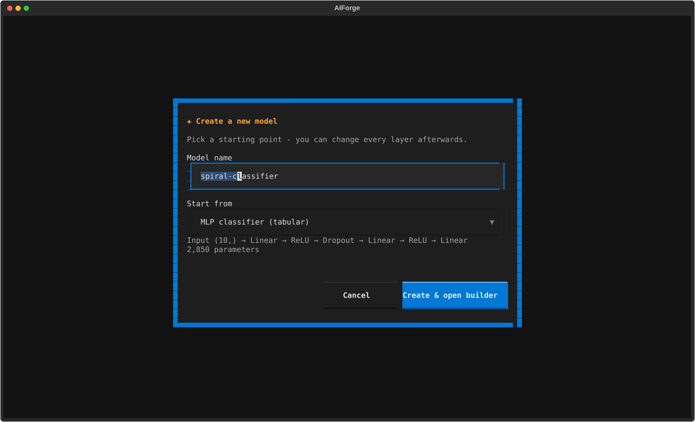

1. Type a name, e.g. `spiral-classifier`
2. Leave **Start from** on *MLP classifier (tabular)*
3. Click **Create & open builder**

### Step 2: look at the model (builder screen)

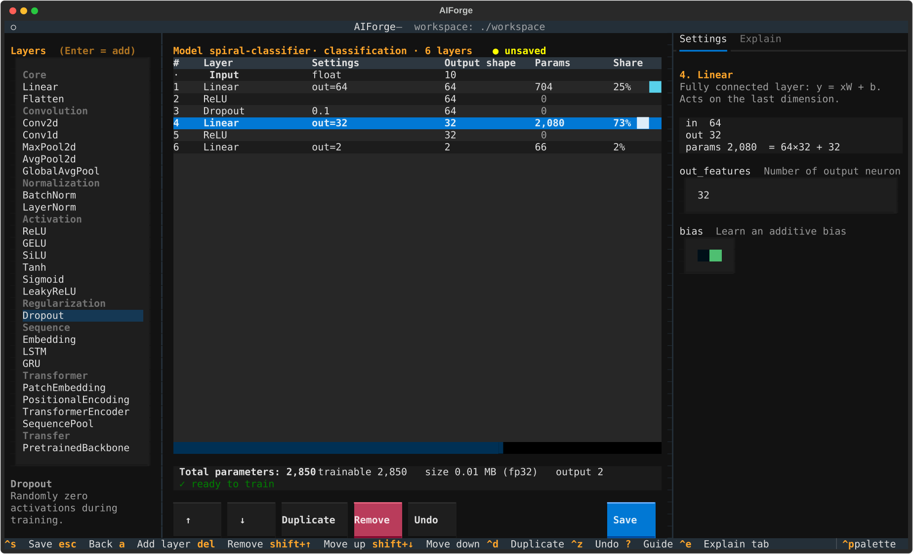

The builder has three columns:

| Column | What it shows |
|---|---|
| **Left: Layers** | All the building blocks you can add. Highlight one and press **Enter** to add it below the selected row. The box at the bottom explains the highlighted layer. |
| **Middle: your model** | Your layers from top (input) to bottom (output). For each layer: the **output shape**, how many **parameters** it has, its **share** of all parameters, and **how that number is calculated**. |
| **Right: settings** | The settings for the selected layer. Change a number and the whole table updates straight away. |

In the screenshot, layer 4 (`Linear`, 64 → 32) has `64×32 + 32 = 2,080` parameters, which is
73% of the model. The bar at the bottom shows the total (2,850), the size (0.01 MB), and
**✓ ready to train**.

You don't need to change anything for this tutorial. Press **`Ctrl+S`** to save, then
**`Esc`** to go back.

> **What if I make a mistake?** The builder shows it immediately in red. For example, adding
> an image layer (`Conv2d`) after a `Flatten` layer gives:
>
> 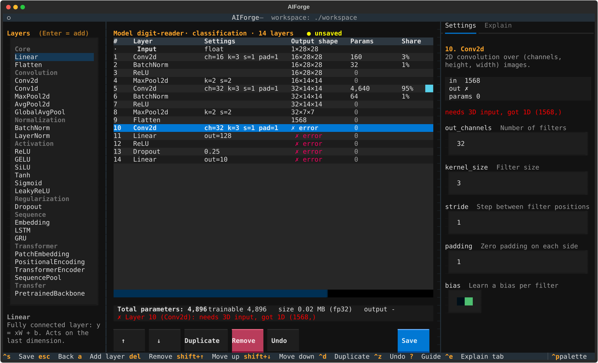
>
> Press **`Ctrl+Z`** to undo, or **`Del`** to remove the layer.

### Step 3: train it

Make sure your model is selected in the list, then press **`t`** (or click **▶ Train**).

1. **① Data**: leave it on *Synthetic toy data* and choose **spirals**.
2. Click **Load data**. AIForge shows what it found: 2 input values, 3 classes, 1,599
   training samples and 399 validation samples.
3. A yellow warning appears: the model was made for 10 inputs and 2 classes, but this data
   has 2 inputs and 3 classes.

   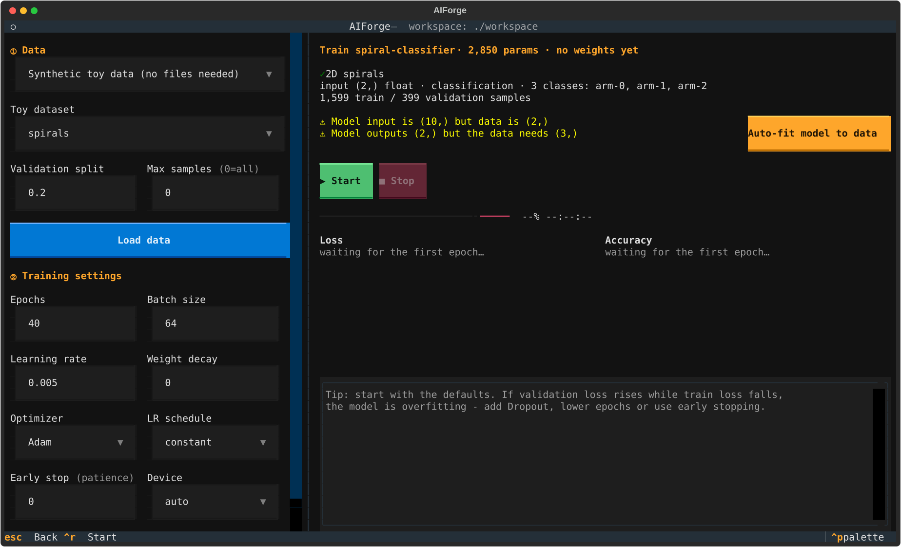

   Click **Auto-fit model to data**. AIForge adjusts the input and output layers for you.
4. **② Training settings**: set **Epochs** to `40` and **Learning rate** to `0.005`.
5. Click **▶ Start** (or press `Ctrl+R`).

Watch it learn:

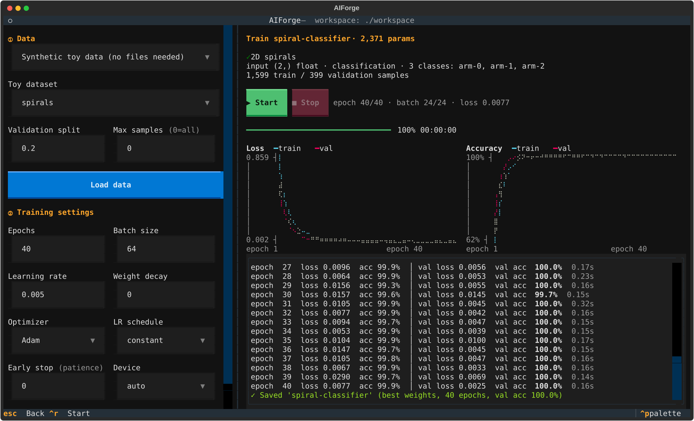

- The **Loss** chart going **down** means the model is making fewer mistakes.
- The **Accuracy** chart going **up** means it's getting more answers right.
- The log lists every epoch. At the end you'll see something like
  `✓ Saved 'spiral-classifier' (best weights, 40 epochs, val acc 100.0%)`.

Press **`Esc`** to go back.

### Step 4: use it

Press **`p`** (or click **◉ Use**). Type two numbers, e.g. `0.1, 0.45`, and press Enter:

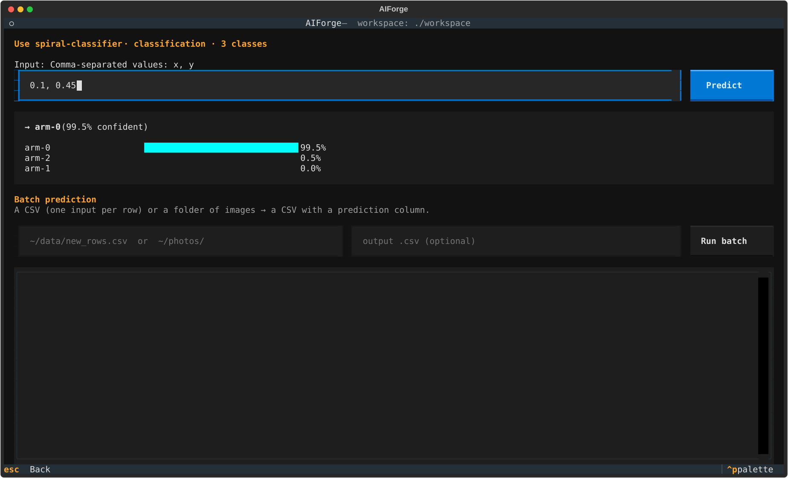

The model answers **arm-0** and shows how confident it is in each class.

### Step 5: export it

Press **`x`** (or click **⇩ Export**). Tick the formats you want with the **space bar** or
mouse, then click **⇩ Export**:

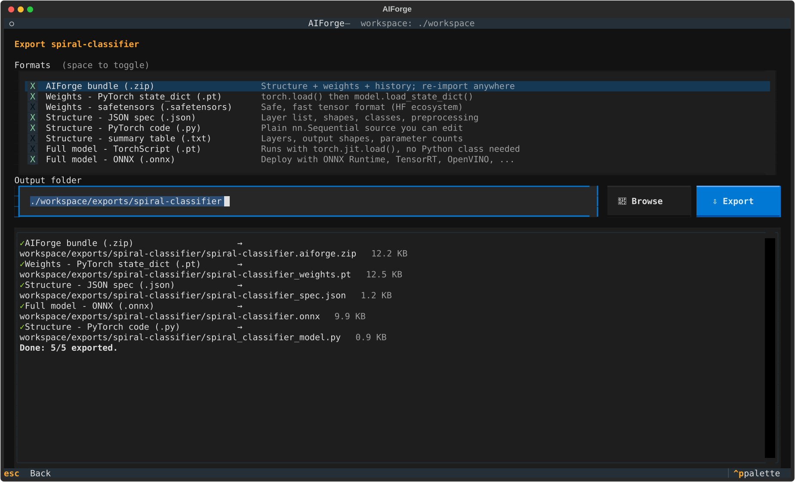

Your files are now in `workspace/exports/spiral-classifier/`.

**🎉 You built, trained, used and exported a neural network without writing code.**

---

## 5. Every screen explained

### 5.1 Home: the model library


- **Left:** all your models. *Weights: trained* means it has been trained; *none* means it
  hasn't been trained yet.
- **Right:** a summary of the selected model (its layers and their sizes) and every training
  run you've done.
- **Buttons:** New · Import · Load weights · Duplicate · Rename · Delete (left) and
  Edit · Train · Fine-tune · Use · Export (right).

### 5.2 Builder: design the model

See [Step 2](#step-2-look-at-the-model-builder-screen) for the layout. Useful actions:

| I want to… | Do this |
|---|---|
| Add a layer | Press `a` (or click the Layers list), highlight a layer, press **Enter** |
| Change a layer's settings | Select it in the middle table and edit the boxes on the right |
| Change the model's input size, input type or task | Select the **Input** row at the top of the table |
| Move a layer up or down | `Shift+↑` / `Shift+↓`, or the **↑ ↓** buttons |
| Copy a layer | `Ctrl+D` |
| Remove a layer | `Del` |
| Undo | `Ctrl+Z` |
| Save | `Ctrl+S` |

> If you change a model that is **already trained**, layers you didn't touch **keep what they
> learned**. Only new or resized layers start from scratch.

**Available layers**

| Group | Layers | Used for |
|---|---|---|
| Core | Linear, Flatten | Every model. `Linear` is the basic "neuron" layer. |
| Convolution | Conv2d, Conv1d, MaxPool2d, AvgPool2d, GlobalAvgPool | Images (2d) and signals (1d) |
| Normalization | BatchNorm, LayerNorm | Steadier, faster training |
| Activation | ReLU, GELU, SiLU, Tanh, Sigmoid, LeakyReLU | Let the model learn non-straight-line patterns. Put one after most Linear/Conv layers. |
| Regularization | Dropout | Reduces overfitting |
| Sequence | Embedding, LSTM, GRU | Text and other sequences |
| Transformer | PatchEmbedding, PositionalEncoding, TransformerEncoder, SequencePool | Transformer models for text or images |
| Transfer | PretrainedBackbone | Reuses a big image model already trained by others (ResNet, EfficientNet…) |

### 5.3 Train: teach the model

The left side has two sections.

**① Data**: where the examples come from

| Option | What you need |
|---|---|
| Synthetic toy data | Nothing. Good for learning how things work. |
| CSV table | A `.csv` file. Choose which column to predict (**Target column**). |
| CSV with text | A `.csv` file with a text column and a label column |
| Image folder | A folder with **one sub-folder per class** |
| MNIST / Fashion-MNIST / CIFAR-10 | Nothing. Downloaded automatically the first time. |

**Validation split** (default `0.2`) keeps 20% of the data aside to *test* the model on
examples it never trained on. **Max samples** limits how much data is used (`0` = all), which
is handy for a quick test on a big dataset.

**② Training settings**

| Setting | Meaning | Good starting value |
|---|---|---|
| Epochs | How many times the model sees the whole dataset | 10–50 |
| Batch size | How many examples it looks at before each update | 32–128 |
| Learning rate | How big each learning step is. Too high: unstable. Too low: slow. | 0.001 |
| Weight decay | Gently keeps weights small, which helps against overfitting | 0 (try 0.01) |
| Optimizer | The method used to update weights | Adam |
| LR schedule | Lowers the learning rate over time | constant (try cosine) |
| Early stop | Stop if validation loss hasn't improved for this many epochs (0 = off) | 0 or 5 |
| Device | Where to run: CPU or GPU | auto |
| Continue from saved weights | On: keep training the existing model. Off: start over from scratch. | On |

**Right side:** loss and accuracy charts, a progress bar, and a log of each epoch. Click
**■ Stop** at any time. AIForge always keeps the **best** version, i.e. the epoch with the
lowest validation loss.

### 5.4 Fine-tune: reuse a trained model for a new task

Fine-tuning starts from a model that has **already learned something** and teaches it a new,
related task. It's usually faster and needs less data than training from scratch.

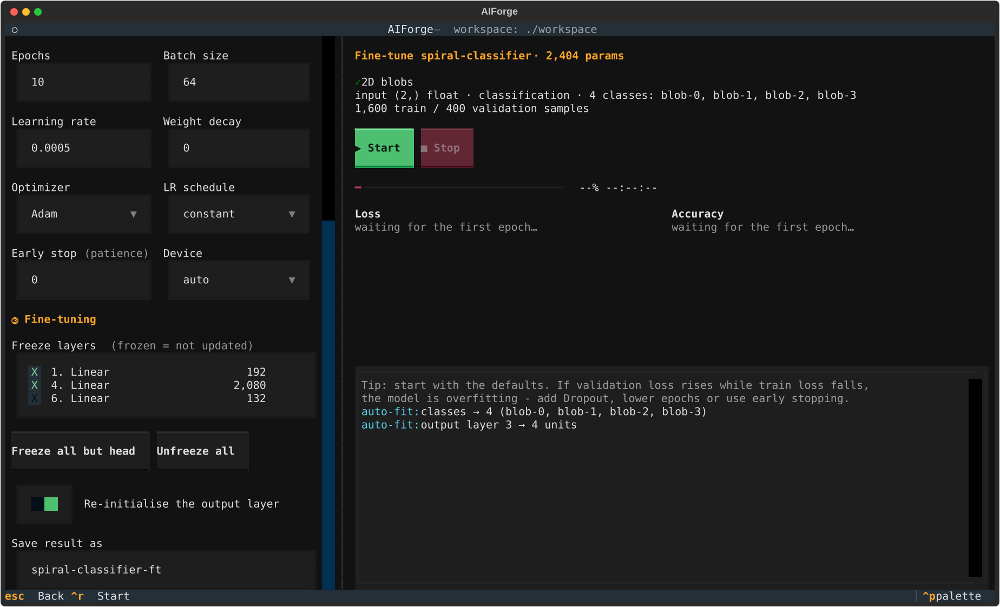

It works like Train, plus a **③ Fine-tuning** section:

- **Freeze layers:** ticked layers are **frozen**, meaning they won't change. Click **Freeze
  all but head** to keep everything the model learned and only retrain the last layer.
- **Re-initialise the output layer:** gives the last layer a fresh start. This is switched on
  automatically when the new data has different classes.
- **Save result as:** the fine-tuned model is saved under a **new name**, so your original
  model stays safe.

The learning rate starts lower (`0.0005`) because fine-tuning should only nudge the model.

### 5.5 Use: get predictions

What you type depends on the model:

| Model trained on | Type this |
|---|---|
| CSV table | The values in column order, separated by commas, e.g. `6, 3.5, red`. The screen shows the expected columns. |
| Text | A sentence, e.g. `what an amazing movie` |
| Images | The path to an image file, e.g. `~/Pictures/cat.jpg` |

**Batch prediction:** give it a whole CSV file or image folder. It writes a new CSV with a
`prediction` column (plus `confidence` for classification models).

### 5.6 Export: save the model for other programs

| Format | File | Choose this if you want to… |
|---|---|---|
| AIForge bundle | `.aiforge.zip` | Back up the model or share it with another AIForge user (re-import with `i`) |
| Weights (PyTorch) | `_weights.pt` | Load the weights in your own PyTorch code |
| Weights (safetensors) | `.safetensors` | Share safely; also used by Hugging Face |
| Structure (JSON) | `_spec.json` | Keep a readable description of the layers |
| Structure (PyTorch code) | `_model.py` | Get real Python code for the model, to learn from or edit |
| Summary | `_summary.txt` | Print or paste a layer table into a report |
| TorchScript | `_torchscript.pt` | Run the model in C++ or on mobile with PyTorch |
| ONNX | `.onnx` | Run it almost anywhere: ONNX Runtime, TensorRT, OpenVINO, browsers… |

### 5.7 Import: bring in an existing model

Press **`i`** on the home screen and enter a file path.

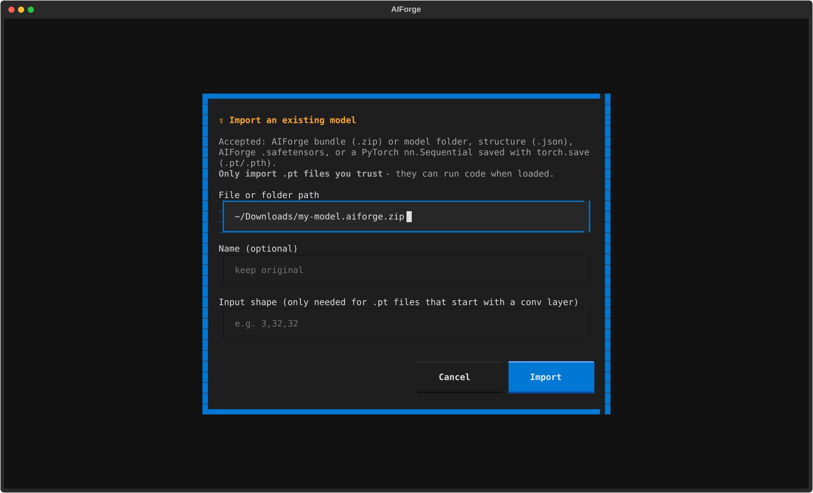

| You have | What happens |
|---|---|
| An AIForge `.zip` bundle or model folder | Imported exactly, including weights and history |
| An AIForge `.json` structure | Imported as an untrained model |
| An AIForge `.safetensors` file | Imported with its weights |
| A PyTorch `nn.Sequential` saved with `torch.save(model)` | Converted into editable layers, weights kept. If it starts with a conv layer, fill in the input shape, e.g. `3,32,32`. |
| Only a weights file (state_dict) | Select a model with the same structure and press **`w`** (Load weights) instead |

> ⚠️ **Only import `.pt` / `.pth` files from people you trust.** These files can contain
> hidden code that runs when they are opened.

---

## 6. Using your own data

Small sample files are in the [`examples/`](examples) folder, so you can try each format
right away.

### 6.1 A table (CSV): predict a category or a number

One row per example, with a header row. The **last column** is the one to predict, unless
you choose another column.

```csv
size,weight,color,label
5.05,1.96,green,small
6.13,2.75,green,big
```

- Number columns are scaled automatically.
- Text columns like `color` are turned into codes automatically.
- Empty number cells are filled with the column average.
- If the target column holds numbers with many different values, AIForge treats it as
  **regression** (predicting a number). Otherwise it's **classification** (predicting a
  category). You can override this with the **Task** setting.

Examples: [`fruit_size.csv`](examples/fruit_size.csv) (classification) and
[`house_prices.csv`](examples/house_prices.csv) (regression; choose `price` as the target).

### 6.2 Text (CSV): classify sentences

One column with text and one with the label:

```csv
text,sentiment
"great movie, loved the actors",pos
"boring plot and awful ending",neg
```

Use the template **Text Transformer classifier** or **Text classifier (Embedding + LSTM)**.
Example: [`movie_reviews.csv`](examples/movie_reviews.csv).

### 6.3 Images: classify pictures

Make a folder with **one sub-folder per class**. The sub-folder name becomes the class name:

```
my_photos/
├── cat/
│   ├── 001.jpg
│   └── 002.jpg
└── dog/
    ├── 001.jpg
    └── 002.jpg
```

Images are resized to the model's input size automatically (set it on the builder's
**Input** row, e.g. `3,64,64`). Example: [`color_images/`](examples/color_images).

> **How much data do I need?** For images, aim for at least 50–100 per class. With fewer
> images, use the **Transfer learning (ResNet18)** template, which starts from a model that
> already understands images.

---

## 7. Which template should I choose?

| Your data | Template | Size |
|---|---|---|
| A table of numbers/categories, predicting a **category** | MLP classifier (tabular) | tiny |
| A table, predicting a **number** (price, temperature…) | MLP regressor (tabular) | tiny |
| Small grayscale images (28×28, e.g. digits) | Small CNN | ~200K parameters |
| Small colour images (32×32) | CNN (CIFAR-10) | ~67K parameters |
| Photos, especially with **few** examples | Transfer learning (ResNet18) | ~11M parameters |
| Images, to try a modern architecture | Vision Transformer (ViT) | ~546K parameters |
| Sentences / reviews | Text Transformer classifier | ~2.8M parameters |
| Sentences, simpler / faster | Text classifier (Embedding + LSTM) | ~1.4M parameters |
| You want to design everything yourself | Blank | — |

You can change any template after creating it.

---

## 8. How to read the training charts

| What you see | What it means | What to do |
|---|---|---|
| Both loss lines go **down** and level off | 👍 The model is learning well | Nothing; it's working |
| Train loss goes down, **val loss goes up** | **Overfitting**: it memorizes the training data instead of learning general rules | Add a `Dropout` layer, train fewer epochs, turn on Early stop, or get more data |
| Both lines stay **high** and flat | **Underfitting**: the model is too simple, or isn't learning | Train more epochs, add layers or neurons, or try a higher learning rate |
| Lines **jump around** wildly | The learning rate is too high | Lower it, e.g. 0.001 → 0.0003 |
| Loss shows `nan` | Training broke down (numbers became too large) | Lower the learning rate a lot and start again |

---

## 9. Words you will see

| Word | Plain meaning |
|---|---|
| **Model / neural network** | A program that learns patterns from examples instead of being written by hand |
| **Layer** | One step in the model. Data flows through the layers from top to bottom. |
| **Parameters (weights)** | The numbers inside the model that change during training. More parameters can learn more, but need more data and time. |
| **Shape** | The size of the data at each step, e.g. `3×32×32` = an image with 3 colour channels, 32×32 pixels |
| **Training** | Showing the model examples with answers so it adjusts its parameters |
| **Epoch** | One pass through the entire training dataset |
| **Batch** | A small group of examples processed together |
| **Loss** | A score for how wrong the model is. Lower is better. |
| **Accuracy** | The percentage of correct answers (classification only) |
| **MAE** | Mean absolute error: the average size of the mistake when predicting numbers |
| **Validation data** | Examples held back to test the model honestly |
| **Overfitting** | The model memorizes the training examples but fails on new ones |
| **Learning rate** | How big each adjustment is during training |
| **Classification** | Predicting a category (cat/dog, spam/not spam) |
| **Regression** | Predicting a number (a price, a temperature) |
| **Fine-tuning** | Continuing to train an already-trained model on a new task |
| **Freezing** | Locking layers so fine-tuning doesn't change them |
| **Transfer learning** | Starting from a model someone else trained on a huge dataset |
| **Transformer** | A modern type of model that uses *attention*: every part of the input looks at every other part |
| **Export** | Saving the model in a format other programs can use |

---

## 10. Keyboard shortcuts

**Everywhere:** `Esc` back · `Tab` next box · `Enter` confirm · `Ctrl+Q` quit · `Ctrl+P` command palette

| Home | | Builder | | Train / Fine-tune | |
|---|---|---|---|---|---|
| `n` | New model | `a` | Go to the layer list | `Ctrl+R` | Start training |
| `i` | Import | `Enter` | Add the highlighted layer | `Esc` | Back (stop training first) |
| `e` / `Enter` | Edit structure | `Del` | Remove layer | | |
| `t` | Train | `Shift+↑ / ↓` | Move layer | | |
| `f` | Fine-tune | `Ctrl+D` | Duplicate layer | | |
| `p` | Use (predict) | `Ctrl+Z` | Undo | | |
| `x` | Export | `Ctrl+S` | Save | | |
| `w` | Load weights | | | | |
| `c` | Duplicate model | | | | |
| `r` | Rename | | | | |
| `d` | Delete | | | | |
| `q` | Quit | | | | |

---

## 11. Problems and solutions

| Problem | Solution |
|---|---|
| `command not found: aiforge` | Use the full path, `.venv/bin/aiforge`, or activate the environment first: `source .venv/bin/activate` |
| `python3: command not found` | Install Python from [python.org](https://www.python.org/downloads/) (Windows: try `py` instead of `python3`) |
| The screen looks cut off or squashed | Make the terminal window bigger (at least 120×35) or full screen. The banner hides itself on small windows. |
| Strange symbols instead of boxes and lines | Use a modern terminal (iTerm2, Windows Terminal) and a font such as *Cascadia Code*, *JetBrains Mono* or *Fira Code* |
| The mouse doesn't work | Use the keyboard (see the bottom bar), or enable mouse support in your terminal's settings |
| Yellow warning "Model input is … but data is …" | Click **Auto-fit model to data** |
| Red "✗ error" in the builder | Read the message on the right. Usually a layer is in the wrong place (e.g. `Conv2d` after `Flatten`). Remove or move it, or press `Ctrl+Z`. |
| "Every layer is frozen" | In Fine-tune, untick at least one layer |
| Training is very slow | Set **Max samples** to e.g. `5000`, use fewer epochs, or use a smaller template |
| Download of MNIST/CIFAR fails | Check your internet connection. The files are stored in `workspace/data/` after the first download. |
| Predictions look random | Make sure the model is trained (*Weights: trained* on the home screen) and check its validation accuracy in the run history |
| "Expected N values, got M" | Type exactly as many comma-separated values as the hint shows, in the same order |

---

## 12. Where are my files?

Everything lives in the `workspace/` folder (change it with `aiforge -w /another/folder`):

```
workspace/
├── models/
│   └── spiral-classifier/
│       ├── spec.json       ← the model's structure (layers, classes, preprocessing)
│       ├── weights.pt      ← what the model learned
│       └── history.json    ← every training run
├── exports/                ← files created by Export
└── data/                   ← downloaded datasets (MNIST, CIFAR-10…)
```

To back up a model, export it as an **AIForge bundle** or copy its folder.

---

## 13. For developers

```
aiforge/
├── layers.py        layer registry: settings, building, parameter formulas
├── spec.py          model description (JSON), workspace storage, templates, code generation
├── data.py          dataset loaders and input preprocessing
├── trainer.py       training / fine-tuning loop
├── predict.py       single and batch predictions
├── model_io.py      export and import
└── tui/             the terminal interface (Textual): home, builder, train, predict, export
docs/
├── images/              README screenshots
└── make_screenshots.py  regenerates them: .venv/bin/python docs/make_screenshots.py
examples/            small sample datasets
```

Built with [PyTorch](https://pytorch.org) and [Textual](https://textual.textualize.io).
